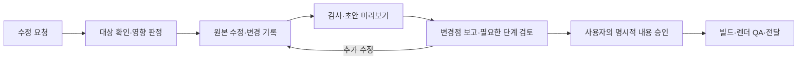

# 발표 수정 절차

완성본과 제작 중인 발표 모두 같은 절차로 수정한다. `slides.md`가 원본이며, 수정 요청은 실행 지시다. 단계별 내용 승인은 [워크플로우](workflow.md)의 명시적 승인 규칙을 그대로 따른다. 수정에 착수하기 위한 별도 승인은 받지 않는다.

## 사용자는 어떻게 요청하나

**어디를 어떻게 바꾸고 싶은지** 말하면 된다. 이유와 유지할 조건이 있으면 함께 말한다. 아래 형식은 예시이며 필수 양식이 아니다. Stage 번호나 문서 이름을 알 필요가 없다.

> PDF 7쪽 그림이 작아. 그림을 더 크게 해줘. 수치와 결론은 그대로 유지해줘.
>
> ‘독립 평가’ 설명이 어려워. 학부생도 이해하도록 용어를 풀고 예시 하나를 넣어줘.
>
> S03에 내용이 너무 많아. 두 장으로 나누고 배경을 줄여서 총 10분은 유지해줘.
>
> 결과보다 실패 원인을 먼저 보여줘. 표지와 실험 수치는 유지해줘.
>
> 청중이 교수님에서 신입생으로 바뀌었어. 배경 설명부터 다시 맞춰줘.
>
> 방금 R002에서 바꾼 표현만 이전으로 되돌려줘.

페이지 번호·토픽·슬라이드 ID·인용한 문장 중 하나로 대상을 가리켜도 된다. PPTX/PDF 쪽수에는 자동 생성된 표지·목차·섹션 페이지가 포함되므로, 에이전트가 사용자가 본 파일과 미리보기에서 실제 본문 ID를 찾는다. 쪽수에서 일정한 숫자를 빼서 ID로 간주하지 않는다. 파일 버전이나 대상이 여럿이면 그 부분만 묻고 독립적으로 처리할 수 있는 요청부터 진행한다.

“전체적으로 더 깔끔하게”처럼 범위가 넓은 요청도 받는다. 에이전트는 현재 결과에서 구체적인 문제와 수정 방향을 설명하고, 기존 목적·메시지·수치를 유지하며 반영한다. 서로 다른 결과를 낳는 해석이 남으면 짧은 선택지로 확인한다.

## plan/에서 무엇을 보나

| 문서 | 역할 | 갱신 주체 |
| --- | --- | --- |
| `interview.md` | 청중·목적·제약의 합의 | 에이전트, 사용자 검토 |
| `brief.md` | 메시지·스토리라인의 합의 | 에이전트, 사용자 검토 |
| `outline.md` | 순서·토픽·주장과 근거의 합의 | 에이전트, 사용자 검토 |
| `contracts.md` | 원본 위치·단계별 승인 상태·의존 관계도·다음 검토 위치 | `rvppt plan`이 생성 |
| `revisions.md` | 요청 원문·대상·변경점·재검토 범위·검증·완료 기록 | 에이전트가 추가 |

여기서 ‘계약’은 단계마다 확인한 합의를 뜻한다. 계약 본문은 기존 승인 문서이며 `contracts.md`는 그 위치와 현재 상태를 모아 보여 주는 뷰다. 별도 승인 체계를 만들지 않는다. `revisions.md`에 “승인”이라고 적는 것만으로 승인되지 않는다.

새 task에는 두 보조 문서가 자동 생성된다. 기존 task에서도 아래 명령으로 만든다. `contracts.md`만 갱신하고 기존 `revisions.md`는 보존한다. `contracts.md`가 사용자가 작성한 문서이면 덮어쓰지 않고 오류를 알린다.

```bash
uv run rvppt plan tasks/<task>
```

관계도는 Mermaid이며 이를 지원하는 Markdown 뷰어에서 볼 수 있다. 같은 정보의 표와 문제 목록도 있어 다이어그램 없이 읽을 수 있다. 이 파일은 **명령 실행 시점의 스냅샷**이다. 재개·수정 후·승인 후·단계 보고 전에 갱신한다. `rvppt status`는 계속 읽기 전용이다.



## 에이전트의 처리 순서

1. **재개와 접수.** `status`와 `plan`을 실행하고 원본·기존 요청 기록·사용자가 본 결과를 확인한다. `plan/revisions.md`에 R001처럼 요청별 ID를 부여하고 원문·대상·유지 조건을 기록한다. 이미 진행 중인 요청을 구체화하는 답변은 그 항목에 추가한다.
2. **영향 판정.** 아래 표와 현재 `status`를 기준으로 최초 재검토 단계와 바뀔 파일을 정한다. “S03을 두 장으로 나누므로 목차와 본문을 고치고 Stage 3~4를 다시 검토합니다”처럼 짧게 알린 뒤 반영한다. 목적·핵심 메시지까지 달라지면 해당 상위 문서부터 고친다. 모호함이 없으면 실행 허가를 다시 묻지 않는다.
3. **반영.** `slides.md`·해당 `plan/` 문서·그림 원본을 수정한다. 한 요청에 무관한 개선을 섞지 않는다. 수치·출처·제약을 보존하고 상위 합의와 모순이 없는지 확인한다. `sources/`의 원자료나 산출 PPTX만 직접 고치지 않는다. 수정 전 비교 자료는 task의 `.build/editorial/`에 둔다.
4. **검증과 보고.** `lint`, 필요한 윤문 검사, `build`·`preview`로 변경 부분과 영향을 받는 페이지를 확인한다. 수정 요청에는 변경 결과를 확인하기 위한 초안 미리보기 요청이 포함된 것으로 본다. 승인 전 결과는 초안으로 표시한다. `status`·`plan`을 다시 실행하고 변경 전→후, 유지한 합의, 재검토할 단계, 남은 문제, 실제 수행한 검사를 보고한다.
5. **필요한 단계 승인.** `next_stage`부터 해당 단계의 필수 보고와 최신 `review_hash`를 제시한다. 명시적 승인 후 `approve --expected-hash`로만 기록하고 `plan`을 갱신한다. 상위 재승인 뒤 draft로 돌아간 하위 단계는 각각 다시 보고하고 승인받는다. 변경 요청·선택지 답변·“수정해줘”를 내용 승인으로 기록하지 않는다. 여전히 유효한 단계는 재승인을 요구하지 않는다.
6. **QA와 완료.** 모든 내용 승인이 유효하면 최종 빌드·미리보기를 확인한다. 요청 기록에 변경 파일·승인 발언과 해시·검증 결과·산출물 링크를 남긴다. 아직 승인이 필요하면 ‘검토 대기’, 제작 QA까지 마쳤으면 ‘QA 완료’로 기록한다. 보류·취소는 이유를 남기며 미완료를 완료로 표시하지 않는다.

## 어디부터 다시 검토하나

아래는 예상 범위다. 실제 판정은 `status`가 우선이며, 숨은 상위 변경을 임의로 면제하지 않는다. 입력 해시는 [schemas.md](schemas.md)의 규칙을 따른다.

| 변경 | 수정할 원본 | 재검토 시작 |
| --- | --- | --- |
| 오탈자·불릿·노트·표지·핵심 문장 표현 | `slides.md` | Stage 4 |
| 그림 교체·추가·삭제, GIF와 대표 PNG 변경 | `figures/`, 필요 시 `slides.md` | Stage 4 |
| 슬라이드 추가·삭제·분할·순서·토픽·섹션 변경 | `plan/outline.md`, `slides.md` | Stage 3 |
| 핵심 메시지·스토리라인 변경 | `plan/brief.md`와 하위 문서 | Stage 2 |
| 청중·목적·성공 기준·제약 변경 | `plan/interview.md`와 하위 문서 | Stage 1 |
| `sources/` 추가·변경·삭제·파일명 변경 | 원자료는 사용자가 제공, 관련 문서는 에이전트가 갱신 | Stage 1 |
| 빌드·미리보기 재실행, 두 보조 문서 갱신 | 산출물, `contracts.md`·`revisions.md` | 내용 승인은 유지, 제작 QA 확인 |

예컨대 본문에서 결론 자체를 바꾸는 요청은 표현 수정으로 처리하지 않는다. 핵심 메시지가 달라지면 Stage 2까지 올라간다. “그림을 크게”는 입력에 좌표·크기를 쓰지 않고 본문 축약·분리 등 고정 양식 내에서 해결한다. 공통 양식·코드의 변경이 필요하면 발표 내용 수정과 구분해 설명한다.

되돌리기도 새 수정으로 처리한다. 원본의 해당 변경을 복원한 뒤 `status`로 현재 승인 유효성을 확인한다. 과거 승인 필드·해시를 복사하거나 재생성된 PPTX로 원본을 덮어쓰지 않는다.

## 수정 보고 예

> R003 — ‘독립 평가’(본문 S02, 검토한 PDF 7쪽)
>
> 용어 두 개를 풀어 쓰고 그림 옆의 중복 설명을 줄였습니다. 수치·결론·슬라이드 순서는 유지했습니다. 변경 원본은 `slides.md`이며 Stage 1~3의 승인은 유효합니다. Stage 4는 본문 변경으로 다시 검토가 필요합니다.
>
> 변경 전→후 문장과 초안 PNG, 검사 결과, 남은 문제를 함께 제시합니다. 이어서 Stage 4 필수 보고·문서 링크·최신 review_hash를 제시하고 이 내용의 승인을 요청합니다.

실제 보고에서는 위 설명 자리에 실제 변경점·검사 결과·해시·링크를 넣는다. 파일을 열어야만 판단할 수 있는 보고는 하지 않는다.
