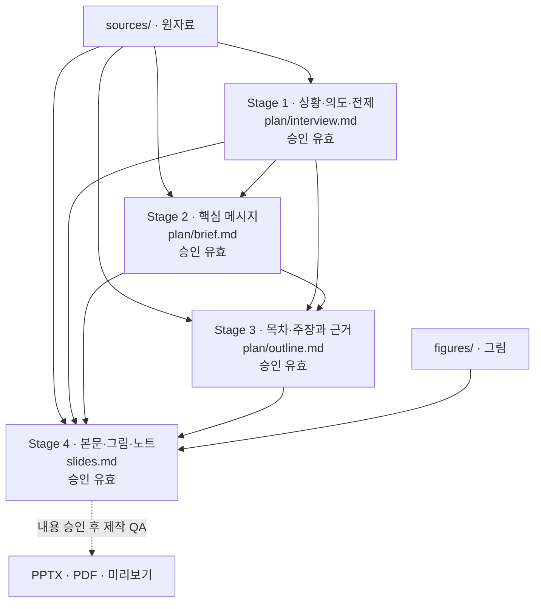

<!-- Generated by rvppt plan; do not edit. -->
# 합의와 승인 관계도

Task: `261011-example-il-progress`

이 파일은 생성 시점의 상태다. 수정·승인 뒤 `uv run rvppt plan tasks/261011-example-il-progress`로 갱신한다.
승인 판정의 원본은 각 문서의 메타데이터와 `rvppt status`다. 이 문서를 편집해도 승인되지 않는다.

내용 승인: **완료**. 디자인·렌더 QA는 별도다.
다음 작업: 빌드·렌더 QA와 미리보기 확인(이 문서는 QA 완료를 판정하지 않는다).

화살표는 승인 의존 관계다. 상위 입력이 바뀌면 연결된 하위 승인도 다시 확인한다.

| 단계 | 합의 대상 | 원본 | 현재 상태 |
| --- | --- | --- | --- |
| 1 | 상황·의도·전제 | [plan/interview.md](interview.md) | 승인 유효 |
| 2 | 핵심 메시지 | [plan/brief.md](brief.md) | 승인 유효 |
| 3 | 목차·주장과 근거 | [plan/outline.md](outline.md) | 승인 유효 |
| 4 | 본문·그림·노트 | [slides.md](../slides.md) | 승인 유효 |

## Stage 1 — 상황·의도·전제

검토 해시 (`review_hash`): `4eb5d425b790a1da241343347c802ff7a05ea76901ff77ede344d7fc7453a7f2`

- 청중: 모방학습 기본 개념을 아는 지도교수와 로봇팀 대학원생
- 목적: 다음 실험에서 시연 보강과 평가 확대 중 무엇을 먼저 할지 결정받는다
- 핵심 근거: sources/eval.csv — 조건별 40회 합성 평가 / sources/failures.csv — ACT-8 실패 유형 합성 집계
- 성공 기준: 청중이 k = 8 결과와 표본 한계를 함께 기억한다 / 다음 실험 우선순위에 대한 결정을 받는다
- 제약: 주간 랩미팅 10분 / 실제 로봇 결과는 아직 없다
- 가정: 가상 예제: 인물·과제·수치가 모두 합성이며 실제 실험 결과가 아니다.
- 가정: 예제 시연용으로 에이전트가 자동 승인했다. 실제 발표자의 승인이 아니다.

## Stage 2 — 핵심 메시지

검토 해시 (`review_hash`): `2d1d86d96c7471e0cb3c184cdf742f2fa05d741315314f4c17cd49fbe88c66cb`

- 주제: 행동 청크 길이 비교 진행 보고
- 핵심 메시지: k = 8이 가장 좋았지만 실패의 절반이 파지에서 나므로 시연 보강부터 결정받는다
- 스토리라인: 지난 피드백과 목표 / 실험 설정 / 성공률과 실패 분석 / 다음 계획과 결정 요청
- 가정: 가상 예제: 인물·과제·수치가 모두 합성이며 실제 실험 결과가 아니다.
- 가정: 예제 시연용으로 에이전트가 자동 승인했다. 실제 발표자의 승인이 아니다.

## Stage 3 — 목차·주장과 근거

검토 해시 (`review_hash`): `54b53d01e32998f111759d3f8d8cbb824f7c2f9479c7c8b194a9bc4a1f7336c8`

- 발표 시간(분): 10

| ID | 섹션 | 토픽 | 핵심 문장 | 근거 | 초 | 그림 계획 |
| --- | --- | --- | --- | --- | --- | --- |
| S01 | 지난 미팅 이후 | 진행 목표 | 원리와 실패 분석을 연결해 다음 실험을 정합니다 | ['sources/eval.csv', 'figures/external/act-2023.pdf'] | 30 | figures/aloha-teleoperation.png — ACT Fig. 1 왼쪽 원문 사진; 외부 시연 사례 |
| S02 | 실험 설정 | BC 원리 | BC는 시연의 관측에서 전문가 행동을 예측합니다 | ['figures/external/dagger-2011.pdf'] | 40 | figures/bc-illustrated.png — 로봇·물체·전문가를 담은 AI 설명용 삽화; 실험 증거 아님 |
| S03 | 실험 설정 | 분포 이동 | 작은 행동 오차가 시연에 없던 상태로 이어집니다 | ['figures/external/dagger-2011.pdf'] | 45 | figures/distribution-shift-illustrated.png — 로봇·물체·전문가를 담은 AI 설명용 삽화; 실험 증거 아님 |
| S04 | 실험 설정 | DAgger | DAgger는 정책이 방문한 상태에 전문가 행동을 붙입니다 | ['figures/external/dagger-2011.pdf'] | 40 | figures/dagger-illustrated.png — 로봇·물체·전문가를 담은 AI 설명용 삽화; 실험 증거 아님 |
| S05 | 실험 설정 | ACT 구조 | ACT는 현재 관측에서 여러 단계의 행동을 예측합니다 | ['figures/external/act-2023.pdf'] | 40 | figures/act-architecture.png — 원문 기반 도식 또는 기존 합성 CSV의 재시각화 |
| S06 | 실험 설정 | 학습 목표 | 예제의 청크 손실은 ACT의 전체 목적을 단순화했습니다 | ['figures/external/act-2023.pdf'] | 45 |  |
| S07 | 실험 설정 | 시간 앙상블 | 같은 시점의 행동 예측을 모아 실행을 부드럽게 합니다 | ['figures/external/act-2023.pdf'] | 45 | figures/temporal-ensemble.png — 원문 기반 도식 또는 기존 합성 CSV의 재시각화 |
| S08 | 실험 설정 | 과제와 데이터 | 시연 200개와 조건별 40회 평가를 가정했습니다 | ['sources/eval.csv'] | 30 |  |
| S09 | 결과 | 성공률 | 합성 평가에서는 k = 8의 성공 횟수가 가장 많았습니다 | ['sources/eval.csv'] | 55 | figures/success-by-chunk.png — 원문 기반 도식 또는 기존 합성 CSV의 재시각화 |
| S10 | 결과 | 성공률 | k = 16의 하락 원인은 이 집계만으로 알 수 없습니다 | ['sources/eval.csv'] | 40 |  |
| S11 | 결과 | 실패 분석 | k = 8의 실패 11회 중 파지 실패가 6회였습니다 | ['sources/failures.csv'] | 45 | figures/failure-types.png — 원문 기반 도식 또는 기존 합성 CSV의 재시각화 |
| S12 | 다음 계획 | 다음 실험 | 파지 시연을 보강하고 실행 조건을 고정해 비교합니다 | ['sources/failures.csv'] | 40 | figures/next-experiment.png — 원문 기반 도식 또는 기존 합성 CSV의 재시각화 |
| S13 | 다음 계획 | 논의 | 시연 보강의 우선순위와 실제 로봇 평가 기준을 정합니다 | ['sources/eval.csv'] | 35 |  |
| S14 | 부록 | 방법 비교 | 세 방법은 서로 다른 모방학습 문제를 다룹니다 | ['figures/external/diffusion-policy-2023.pdf'] | 15 |  |
| S15 | 부록 | 논문 레퍼런스 | 원리 설명은 원문 논문, 결과는 합성 CSV에 근거합니다 | ['figures/visual-sources.yaml'] | 15 |  |

- 가정: 가상 예제: 인물·과제·수치가 모두 합성이며 실제 실험 결과가 아니다.
- 가정: 예제 시연용으로 에이전트가 자동 승인했다. 실제 발표자의 승인이 아니다.

## Stage 4 — 본문·그림·노트

검토 해시 (`review_hash`): `ba490aca291f582c0169f198cec4eb4e455567aeda7eab8f7cb54e410ad25a5e`

- 발표 언어: ko
- 가정: 가상 예제: 인물·과제·수치가 모두 합성이며 실제 실험 결과가 아니다.
- 가정: 예제 시연용으로 에이전트가 자동 승인했다. 실제 발표자의 승인이 아니다.

수정 요청과 처리 이력: [revisions.md](revisions.md). 요청을 승인으로 해석하지 않는다.
