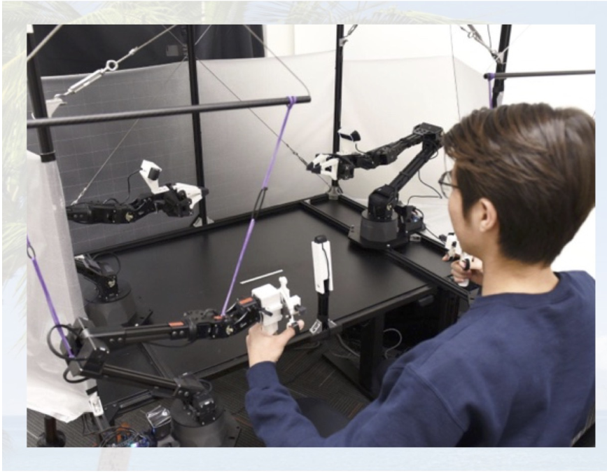
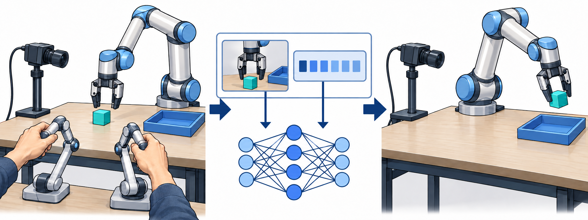
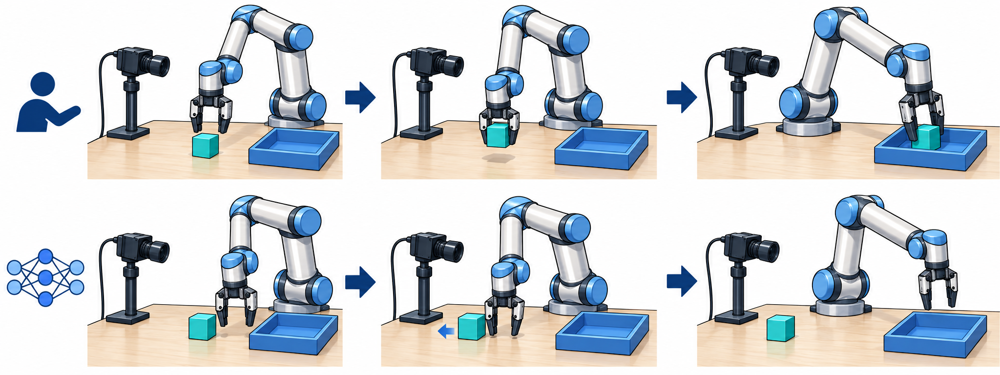
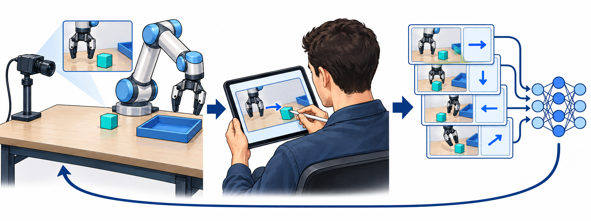
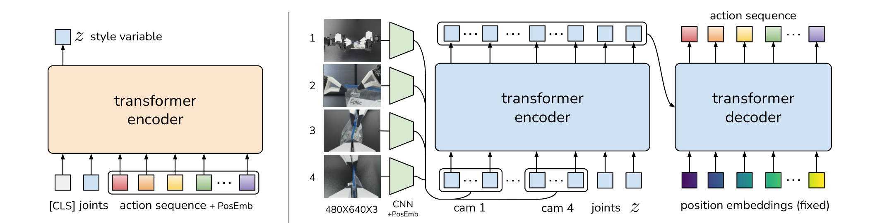
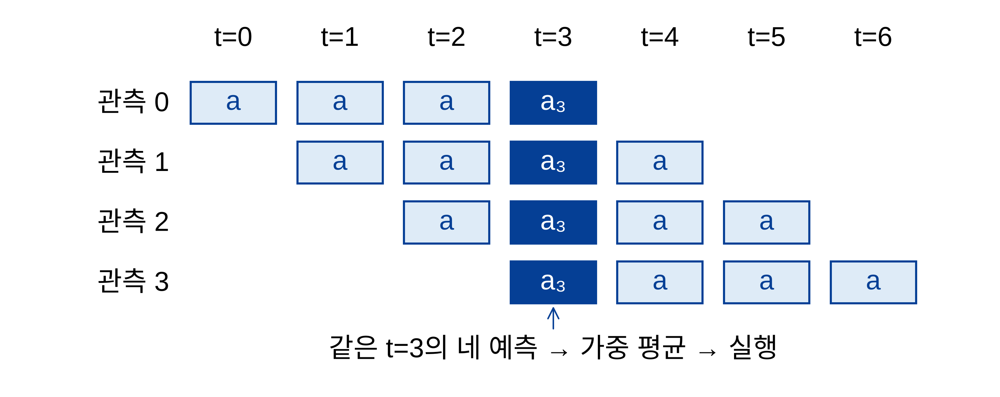
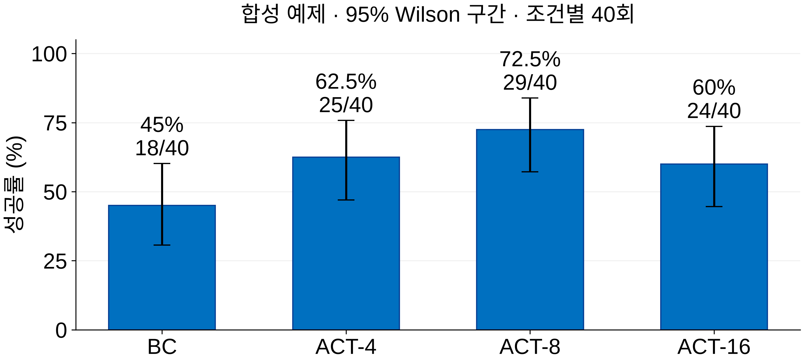
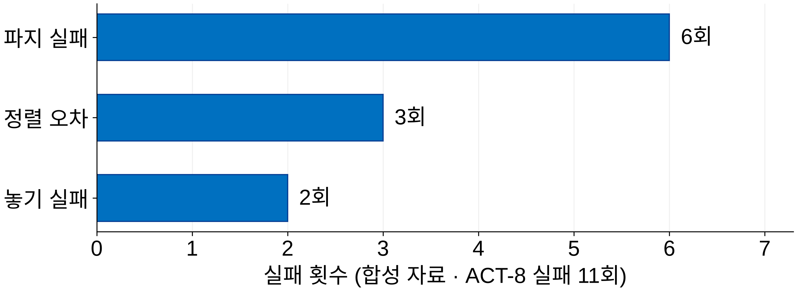
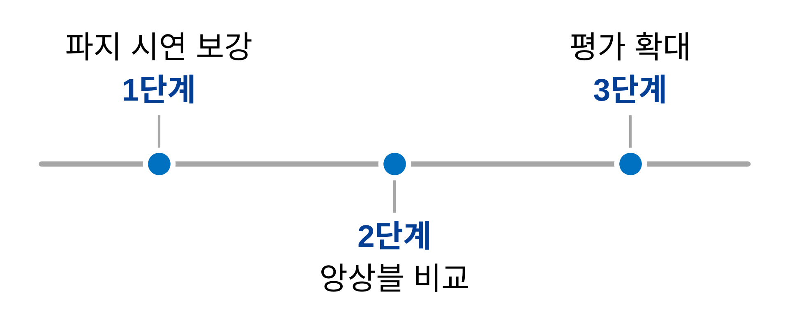

# 지난 미팅 이후 | Since Last Meeting

## 진행 목표

### 원리와 실패 분석을 연결해 다음 실험을 정합니다

- 이번 질문: 행동 청크 길이 $k$가 달라지면 무엇이 바뀌는가?
- 범위: pick-and-place 합성 예제, 실제 로봇 실험 아님

::: source
출처: Zhao et al., 2023, Fig. 1 왼쪽 패널
:::

::: notes
ALOHA 사진은 ACT 논문 PDF 1페이지 Figure 1의 왼쪽 시연 패널이다. 인간이 leader 로봇을 조작하고 follower가 따라 움직이는 외부 연구 사례이며 이 합성 예제의 실제 실험 장면이 아니다. 원문 캡션: A Low-cost Open-source Hardware System for Bimanual Teleoperation. 발표자·과제·실험 수치는 기존 예제의 가상 설정이다. 논문에서 확인한 방법 원리와 합성 평가 결과를 구분한다. 모방학습의 원리에서 출발해 기존 예제의 다음 실험 결정을 설명한다.
:::

# 실험 설정 | Setup

## BC 원리

### BC는 시연의 관측에서 전문가 행동을 예측합니다

- 학습 데이터: 관측 $o_t$와 전문가 행동 $a_t$의 쌍
- 실행: 현재 관측 → 정책 $\pi_\theta$ → 예측 행동

::: source
원리: Ross et al., 2011, §2 · 삽화: AI 생성
:::

::: notes
삽화는 일반적인 로봇 시연·학습·실행을 설명하는 AI 생성 이미지이며 ALOHA의 정확한 하드웨어 구성이나 실험 기록을 재현한 것이 아니다. 왼쪽은 사람의 시연, 가운데는 관측과 행동을 짝지은 학습 예, 오른쪽은 학습한 정책의 실행을 보여준다. 신경망 그림은 특정 구조를 뜻하지 않는다. Behavioral Cloning은 모방학습의 한 접근이다. 모든 모방학습이 행동 회귀인 것은 아니다. 카메라 이미지와 로봇 상태를 관측으로, 목표 관절 위치 등을 행동으로 삼을 수 있다. 연속 행동에서는 예측 행동과 시연 행동 사이의 회귀 손실을 최소화한다. 이 예제는 보상 함수를 학습하거나 강화학습하는 설정이 아니다. Ross, Gordon, Bagnell. A Reduction of Imitation Learning and Structured Prediction to No-Regret Online Learning. AISTATS 2011, PMLR 15:627–635. https://proceedings.mlr.press/v15/ross11a.html
:::

## 분포 이동

### 작은 행동 오차가 시연에 없던 상태로 이어집니다

- 위: 시연에서는 물체를 잡아 트레이로 이동
- 아래: 파지가 빗나가면 다음 관측도 달라짐

::: source
원리: Ross et al., 2011, §2–3 · 삽화: AI 생성
:::

::: notes
AI 생성 삽화의 위 행은 시연, 아래 행은 설명용 정책 오차 사례다. 가운데 아래 그림에서는 물체가 밀려나고 마지막에는 빈 그리퍼가 트레이로 이동한다. 이 사례는 특정 모델의 실측 실패가 아니다. 로봇이 물체 옆을 잘못 짚으면 다음 관측도 시연과 달라진다. 낯선 입력에서 또 틀리면 이후의 상태가 더 달라질 수 있다. 항상 오차가 커진다는 법칙이나 실측 궤적을 그린 것이 아니다. 정책의 방문 상태 분포가 전문가의 분포와 달라지는 covariate shift를 설명한다. 학습 손실이 작다는 사실만으로 장기 실행의 성공을 보장할 수 없다.
:::

## DAgger

### DAgger는 정책이 방문한 상태에 전문가 행동을 붙입니다

- 정책 실행 → 방문 상태에 대한 전문가 행동 질의
- 기존 데이터에 누적한 뒤 정책 재학습

::: source
원리: Ross et al., 2011, Algorithm 3.1 · 삽화: AI 생성
:::

::: notes
AI 생성 삽화는 정책 실행 중 방문한 상태를 전문가가 화면에서 보고 행동을 라벨링하고 기존 데이터에 누적하는 절차를 보여준다. 화면의 화살표는 관측 이미지에서 전문가가 지정하는 행동의 개념 표기이며 측정한 제어 명령이 아니다. 사람이 로봇을 직접 고쳐 움직이는 장면이 아니다. 새 정책의 성공도 보장하지 않는다. DAgger는 Dataset Aggregation이다. 원 논문은 반복마다 전문가와 학습 정책을 혼합한 정책으로 상태를 방문할 수 있게 한다. 실제 실행 과정에 전문가를 질의할 수 있다는 전제가 필요하며, 로봇에서는 안전한 실행과 추가 라벨링 부담을 고려해야 한다. 이 예제에서 DAgger를 실행했다는 뜻은 아니다. 실패 전후 구간의 전문가 시연을 보강하는 다음 계획과 원리 수준에서 연결한다. 시연 50개를 추가하는 것만으로 DAgger가 되는 것은 아니다.
:::

## ACT 구조

### ACT는 현재 관측에서 여러 단계의 행동을 예측합니다

- 학습: 행동 시퀀스를 잠재 변수 $z$로 압축
- 실행: 학습 인코더를 제외하고 $z = 0$ 사용

::: source
출처: Zhao et al., 2023, Fig. 4 (원문 크롭)
:::

::: notes
Tony Z. Zhao, Vikash Kumar, Sergey Levine, Chelsea Finn. Learning Fine-Grained Bimanual Manipulation with Low-Cost Hardware. RSS 2023. https://arxiv.org/abs/2304.13705. 원문 PDF 4페이지 Figure 4의 그림 영역만 크롭했다. 원래 색과 내용을 보존했다. ACT는 Conditional VAE와 Transformer를 이용한다. 왼쪽 인코더는 행동 시퀀스와 관절 관측으로 z를 학습하고, 오른쪽 정책은 여러 카메라 이미지·관절 위치·z를 조건으로 행동 시퀀스를 예측한다. 원 캡션: Architecture of Action Chunking with Transformers (ACT). 학습된 인코더를 테스트 시 제외하고 prior 평균을 쓰는 구조를 설명하는 figure다.
:::

## 학습 목표

### 예제의 청크 손실은 ACT의 전체 목적을 단순화했습니다

$$\mathcal{L}_{\mathrm{chunk}} = \frac{1}{k}\sum_{j=0}^{k-1}\left\|a_{t+j}-\hat a_{t+j}\right\|_1$$

- $k$: 예측 행동 개수, $a$: 시연 행동, $\hat a$: 예측 행동
- ACT의 전체 학습: 재구성 손실 + 잠재 분포의 KL 항
- $k = 1$: 한 단계 예측, BC와 모델 전체가 같다는 뜻은 아님

::: source
출처: Zhao et al., 2023, §IV-B; 예제용 단순화
:::

::: notes
기존 예제의 L1 수식을 보존하되 의미를 좁혔다. 이 수식은 손실의 청크 차원 평균을 설명하며 ACT 전체 구현을 재현하지 않는다. 원문 §IV-B는 L1 재구성 손실을 설명하지만 Algorithm 1에는 MSE가 적혀 있으므로 논문의 의사코드와 본문 표기가 다르다. 여기서는 본문의 L1 설명에 맞춰 예제 수식을 유지하고, KL 정규화 항을 별도로 설명한다. 청크 길이만 1로 바꾼 ACT와 별도로 설계한 BC는 아키텍처·잠재 변수·학습 목적이 다를 수 있다. 기존 CSV의 ACT 라벨은 합성 조건 이름이며 구현 검증을 뜻하지 않는다.
:::

## 시간 앙상블

### 같은 시점의 행동 예측을 모아 실행을 부드럽게 합니다

- 매 시점 새 관측으로 청크를 다시 예측
- 같은 실행 시점에 해당하는 예측을 가중 평균

::: source
출처: Zhao et al., 2023, Fig. 5·Algorithm 2 (재구성)
:::

::: notes
가독성을 위해 k=4로 재구성한 설명용 도식이다. 네 개의 파란 칸은 서로 다른 관측 시점에서 같은 t=3에 대해 내놓은 행동 예측이다. 행동을 시간축 방향으로 평균하는 것이 아니다. 원 논문은 지수 가중치를 사용하고 가장 오래된 예측의 가중치를 w0로 정의한다. 평균은 전환을 부드럽게 하지만 접촉 실패를 해결한다고 보장하지 않는다. 청크 길이 k와 실제 실행 후 재관측 간격은 다른 개념이다. 매 시점 재예측하는 앙상블을 쓰면 긴 청크가 반드시 관측 주기를 늘리는 것은 아니다.
:::

## 과제와 데이터

### 시연 200개와 조건별 40회 평가를 가정했습니다

| 조건 | 청크 길이 k | 학습 시연 | 평가 시행 |
|---|---:|---:|---:|
| BC | 1 | 200 | 40 |
| ACT-4 | 4 | 200 | 40 |
| ACT-8 | 8 | 200 | 40 |
| ACT-16 | 16 | 200 | 40 |

::: source
출처: sources/eval.csv (합성 자료)
:::

::: notes
네 조건이 같은 시연과 평가 환경을 사용한다고 가정한 합성 예제다. CSV에는 평가 횟수와 성공 집계만 있으며 실제 학습 설정·seed·실행 주기·앙상블 유무는 없다. 따라서 이 자료만으로 청크 길이의 인과 효과나 ACT 구현의 우수성을 주장할 수 없다. 논문의 실제 실험 결과와도 비교하지 않는다.
:::

# 결과 | Results

## 성공률

### 합성 평가에서는 k = 8의 성공 횟수가 가장 많았습니다

::: source
출처: sources/eval.csv (합성), 조건별 40회
:::

::: notes
BC 18/40=45%, ACT-4 25/40=62.5%, ACT-8 29/40=72.5%, ACT-16 24/40=60%다. 오차막대는 조건별 성공/실패를 독립 Bernoulli 시행으로 가정해 계산한 95% Wilson score 구간이다. 합성 집계에서 표본 불확실성 표현을 보여 주는 교육용 계산이며 실제 반복 실험의 신뢰도를 의미하지 않는다. 반복 seed 간 변동과 동일 장면에서 평가한 상관은 알 수 없다. 구간 중첩만으로 유의성 여부를 판정하지 않는다. Wilson, E. B. (1927). Probable Inference, the Law of Succession, and Statistical Inference. JASA 22(158):209–212. https://doi.org/10.1080/01621459.1927.10502953
:::

### k = 16의 하락 원인은 이 집계만으로 알 수 없습니다

:::: columns
::: column
**관찰**

- k = 8: 성공 29회
- k = 16: 성공 24회
- 조건별 평가 40회
:::
::: column
**다음 확인**

- 실제 재관측·실행 주기
- 시간 앙상블 유무
- 접촉 전후의 행동·영상
:::
::::

::: notes
긴 청크가 접촉 후 보정을 늦출 수 있다는 것은 여러 가설 중 하나다. 앙상블로 매 시점 관측을 반영하면 청크 길이와 관측 간격은 같지 않다. 먼저 실행 방식을 확인하고 다른 설정을 고정한 비교가 필요하다. 합성 자료의 5회 차이만으로 원인을 정하지 않는다.
:::

## 실패 분석

### k = 8의 실패 11회 중 파지 실패가 6회였습니다

- 파지 구간 시연 보강을 우선 검토
- 실패 유형은 관찰 분류이며 원인 진단은 아님

::: source
출처: sources/failures.csv (합성 자료)
:::

::: notes
파지 실패 6회, 정렬 오차 3회, 놓기 실패 2회다. 합계 11회는 ACT-8의 40-29와 일치한다. 유형 이름만으로 시야 가림·접촉 오차·제어 지연 중 어느 원인인지 알 수 없다. 실제 영상이 없는 예제이므로 기존 실패 장면 요청 상자는 삭제했다. 로봇 사진이나 설명용 그림을 실제 실패 증거로 대신 넣지 않았다.
:::

# 다음 계획 | Next Steps

## 다음 실험

### 파지 시연을 보강하고 실행 조건을 고정해 비교합니다

- 파지 전후 시연 50개 추가: 예제용 계획
- $k = 8$에서 시간 앙상블 유무 비교
- 조건별 100회 평가, 실행 주기·seed 기록

::: notes
세 단계는 순서만 나타내며 가로 간격이 기간을 뜻하지 않는다. 시연 50개와 평가 100회는 기존 예제의 계획 수치다. 같은 학습 자료·평가 장면·실행 주기에서 앙상블 유무를 비교해야 해석할 수 있다. 가능하면 실패 직전·직후 관측과 행동을 함께 저장한다. 전문가 방문 상태만 반복하는 것보다 실패에서 벗어나는 보정 동작을 포함할지 검토한다.
:::

## 논의

### 시연 보강의 우선순위와 실제 로봇 평가 기준을 정합니다

1. 파지 시연 보강과 평가 확대 중 무엇을 먼저 할까?
2. 실제 로봇 평가에 필요한 성공률·안전 기준은 무엇일까?

::: notes
합성 예제의 결과는 설명을 위한 것이며 실제 로봇으로 넘어갈 근거가 아니다. 성공률 기준을 임의로 정하지 않고 발표 뒤 결정받을 항목으로 남긴다. 이번 추천은 실패가 많이 분류된 파지 구간 시연부터 점검하고, 평가 횟수 확대를 이어 가는 것이다.
:::

# 부록

## 방법 비교

### 세 방법은 서로 다른 모방학습 문제를 다룹니다

| 방법 | 핵심 접근 | 필요한 것 |
|---|---|---|
| DAgger | 방문 상태의 데이터 누적 | 전문가 행동 질의 |
| ACT | 행동 청크·시간 앙상블 | 시퀀스 시연 |
| Diffusion Policy | 조건부 확산으로 행동 생성 | 시퀀스 시연·반복 추론 |

::: source
출처: Ross 2011; Zhao 2023; Chi 2023
:::

::: notes
이 표는 성능 순위가 아니라 접근의 차이다. DAgger는 데이터 수집과 학습 분포, ACT는 행동 시퀀스 예측과 실행, Diffusion Policy는 행동 분포 표현을 다룬다. 세 방법을 완전히 배타적인 분류로 읽지 않는다. Diffusion Policy는 관측을 조건으로 행동 시퀀스의 잡음을 반복 제거하고 일부 행동을 실행한 뒤 다시 계획하는 receding horizon control을 사용한다. 다봉 행동 분포를 표현할 수 있지만 이 예제는 해당 모델을 실험하지 않았다. Chi et al. Diffusion Policy: Visuomotor Policy Learning via Action Diffusion. RSS 2023, https://arxiv.org/abs/2303.04137. 논문 초록·§III 참조.
:::

## 논문 레퍼런스

### 원리 설명은 원문 논문, 결과는 합성 CSV에 근거합니다

- Ross et al., 2011, AISTATS: DAgger·분포 이동
- Zhao et al., 2023, RSS: ACT·행동 청크·시간 앙상블
- Chi et al., 2023, RSS: Diffusion Policy
- Wilson, 1927, JASA: 이항 비율의 구간 계산

::: notes
[1] Stéphane Ross, Geoffrey J. Gordon, J. Andrew Bagnell. A Reduction of Imitation Learning and Structured Prediction to No-Regret Online Learning. Proceedings of AISTATS 2011, PMLR 15:627–635. https://proceedings.mlr.press/v15/ross11a.html
[2] Tony Z. Zhao, Vikash Kumar, Sergey Levine, Chelsea Finn. Learning Fine-Grained Bimanual Manipulation with Low-Cost Hardware. Robotics: Science and Systems 2023. https://arxiv.org/abs/2304.13705
[3] Cheng Chi, Zhenjia Xu, Siyuan Feng, Eric Cousineau, Yilun Du, Benjamin Burchfiel, Russ Tedrake, Shuran Song. Diffusion Policy: Visuomotor Policy Learning via Action Diffusion. Robotics: Science and Systems 2023. https://arxiv.org/abs/2303.04137
[4] Edwin B. Wilson. Probable Inference, the Law of Succession, and Statistical Inference. Journal of the American Statistical Association 22(158):209–212, 1927. https://doi.org/10.1080/01621459.1927.10502953
논문 PDF는 figures/external/에 보존하고 생성 도식·논문 크롭의 출처는 figures/visual-sources.yaml에 기록한다. 논문 수치를 합성 결과로 옮기거나 반대로 해석하지 않는다.
:::
